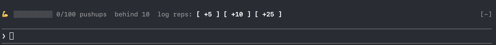

# ❚█═TERMINAL-GYM═█❚

**Your agent put in the reps. You next.**

A Claude Code mod for a daily bodyweight rep goal. While Claude works, you train: log sets from a band above your prompt, keep a streak, and let strict mode spread the reps through your day.

```sh
claude plugin marketplace add DrumAndCode/terminal-gym && claude plugin install terminal-gym@terminal-gym
```

Start a new Claude Code session and the welcome band appears above your prompt.



## Demo (40 seconds)
https://github.com/user-attachments/assets/14373c7e-ad8a-4f92-812b-c93c3201b1b3

## What you get

- **Tracker band** above the prompt: `💪 ▓▓▓▓▓▓░░░░ 60/100 pushups  next set in 23m  log reps: [ +5 ] [ +10 ] [ +20 ]  🔥3d`. The buttons follow your set size: a 300-squat day shows +10 +20 +30. It's grey at 0, yellow once you start, and green as you close in on the goal.
- **Walkthrough**: three steps on first run: what the mod does, pick your program, how streaks and the scoreboard work.
- **Set reminders**: a toast when each set comes due.
- **Long-turn nudges** (easy mode): when Claude works past 30 seconds, a toast and the spinner suggest a set.
- **Strict mode**: today's goal is split into sets spread over your day. Fall behind and your prompts wait until you catch up.
- **Scoreboard** (`/fit streak`): an ASCII barbell (in the terminal), your streak, a 28-day grid and the last week by exercise, with today marked.
- **Progressive goals** (opt-in): hit a goal, and the next session of that exercise asks for about 5% more.
- **Streaks**: count every day you log any reps, for as long as you keep it going. A day with none, or a rest day, resets it. The grid still marks the days you hit the full goal.

## How a strict day works

Strict mode spreads today's goal into evenly spaced sets over a training window (8 hours by default) that starts with your first prompt of the day. With 100 pushups:

| When | What happens |
|---|---|
| First prompt (say 9:00) | The day starts and the opening set is due. Your prompt waits: *"Start the day with a set: 10 pushups. /fit 10 to log it, then send your prompt."* |
| After `/fit 10` | You're through. The band reads `next set in 54m`, counting down |
| 9:53 | Toast: *"⏱ Set due: 10 pushups. 20/100 by now."* Your next prompt waits until you log it |
| …about every 53 minutes… | Ten sets in all, the last due 8 hours after your first prompt |
| Goal done, or a rest day | Nothing waits |

You don't have to pay a debt back all at once. Log a set, even a short one (at least the band's smallest button), and you earn a breather of half the gap between sets (about 26 minutes with the defaults): prompts go through, the band reads `10 due · rest for 27m`, and a toast calls the next set when it ends. What you didn't do stays owed. Log less than the smallest button and your prompts still wait.

A held prompt goes back in the prompt box, so you can send it again once you've logged the set.

Just eaten, or mid-call? `/fit snooze 30` puts the due set off for 30 minutes (up to 60) without logging anything: prompts go through, the band reads `20 due · back at 13:05`, and a toast calls the set when time is up. Each due set can be put off once, and twice a day in all; after that it's a set, even a short one, or `/fit easy`. A `/fit goal` or `/fit window` meanwhile keeps the put-off: the time you asked for stands, and the set due when it ends is the new one.

Know you only have a few hours today? `/fit window 3` spreads the reps you still owe over the next 3 hours, starting now. A window ends by midnight, because the day's log does. The first of those sets is due straight away. `/fit window off` goes back to the default window. `/fit goal 60` changes today's goal and leaves your routine alone.

Only prompts you type can be held. Background tasks, `/loop` runs, messages from other sessions and slash commands like `/fit 10` always go through. Prompts before 5am count as the night before, so a late night never leaves you a wall of overdue sets in the morning.

Easy mode (the default) shows the same schedule on the band and the same reminders, but never holds a prompt.

## Progressive goals

Turn them on with `/fit progress`, or with *Progressive goals* in `/config`. They are off by default.

A goal moves the next time its exercise comes around, at the start of that day:

- **You hit the goal:** the goal goes up one step. A step is 5% of the goal in fives, at least 5. For example, 100 → 105 and 300 → 315. From 150, a step is 10.
- **Two short sessions in a row:** the goal goes back one step.
- **Anything else:** the goal stays.

Only days with reps count as sessions. A rest day or a day with no reps doesn't count, so time away never lowers a goal. A day with its own goal (`/fit goal`) or its own exercise (`/fit swap`) moves nothing.

With the default rotation, 100 pushups on Monday moves Thursday and Sunday to 105 as well. Days that a custom program set to a different goal keep their own. When you hit a goal, the toast tells you the next one: *"Next pushups day: 105."* On the day it moves, a toast says so.

The new goal is written to `routine.json`. Before that, the days before today are frozen at the goals they had, so the grid still shows them as hit. `/fit progress off` stops the changes and keeps the goals where they are.

## Several sessions at once

Every Claude Code session reads the same log in `~/.claude/fitness`, so a set you log in one counts in all of them. Each session checks the log every 10 seconds and redraws its band when another session, or the shell, wrote to it. `/fit reload` does the same read right away.

## Commands

| Command | Does |
|---|---|
| `/fit` | today's progress, pace and streak |
| `/fit 20` | log 20 reps |
| `/fit set 80` | fix today's count |
| `/fit reset` | today back to 0 |
| `/fit goal 60` | change today's goal (your routine stays as it is) |
| `/fit window 3` | spread what's left of today over the next 3 hours (`/fit window off` to undo) |
| `/fit window 1240` | spread what's left of today between now and 12:40 (24-hour clock, `12:40` works too) |
| `/fit snooze 30` | put the due set off 30 minutes (up to 60): prompts go through, the set stays owed. Once per set, twice a day |
| `/fit swap [exercise]` | switch today's exercise: the next in your program, or the one you name, with that exercise's goal |
| `/fit rest` | rest day: no sets due, breaks your streak. Only before you've logged reps that day |
| `/fit rest off` | undo today's rest day (or press **Train today** on the band) |
| `/fit streak` | scoreboard: streak, grid and the last week (run again or press Esc to close) |
| `/fit program` | pick your program (the walkthrough), or **Custom goals** to type each exercise's daily goal |
| `/fit progress` | progressive goals on (`/fit progress off` to stop) |
| `/fit strict` / `/fit easy` | strict mode on / off |
| `/fit help` | every command + strict-mode rules (`/fit rules` still works) |
| `/fit reload` | re-read today's log from disk now (`/fit sync` works too) |
| `/fit start` | replay the welcome |
| `/fit hide` | close panels |

## Settings

In `/config`, under terminal-gym:

| Setting | Default | What it does |
|---|---|---|
| Strict mode | off | Hold typed prompts while you're behind pace |
| Progressive goals | off | Raise an exercise's goal after you hit it, and lower it after two short sessions |
| Training window | 8 hours | How long after your first prompt the day's sets are spread over |
| Set size | auto | Reps per set; auto is a tenth of the goal, rounded to fives |
| Long-turn nudges | on | Easy mode: suggest a set when a turn runs long |
| Nudge after | 30 seconds | How long a turn runs before the nudge |
| Reps per nudge | 10 | The set the nudge suggests |
| Spinner takeover | on | Easy mode: show the suggested set in the spinner |
| Quick-log band | on | Show the tracker band above the prompt |

## Privacy and data

The mod makes no network calls and adds no hidden context for the model. `/fit` replies appear in your conversation like any slash command's output, so Claude can see them. Everything else stays on your machine: a few values in the mod's own store (see below), and your data in `~/.claude/fitness`:

- `routine.json`: the plan per weekday, for example `{ "mon": { "exercise": "pushups", "goal": 100 } }`, with an optional `"unit": "s"` for timed exercises. Edit it for a custom program. With progressive goals on, the mod changes the goals in it.
- `log/YYYY-MM-DD`: that day's count.
- `log/YYYY-MM-DD.skip`: a rest day. If it contains `off`, the rest day was undone.
- `log/YYYY-MM-DD.swap`: that day's plan after `/fit swap` or `/fit goal`, in the same shape as a routine day.
- `log/YYYY-MM-DD.day`: that day's pace, for example `{ "start": 1760000000000, "window": { "from": …, "ms": …, "base": 0 }, "breather": …, "laters": 1, "putOff": 20 }`: when the day started (your first prompt), a `/fit window`, when a breather ends (milliseconds since the epoch), and the `/fit snooze`s taken: how many today, and the due point the last one put off.

## What it does inside Claude Code

A mod runs inside Claude Code, so here is everything Terminal Gym touches:

- **Files it writes:** only its own data in `~/.claude/fitness`: the routine (also when progressive goals move a goal), the daily logs listed above, and `routine.json.bak` (a copy of your custom routine, made before the walkthrough replaces it). It never writes settings files, instructions, build or start-up files directly.
- **Its own store:** two values in the mod's per-plugin store inside Claude Code: the streak cache and whether you've seen the welcome. Everything sessions share (today's start, a `/fit window`, a breather) is in the day's file above, so every session reads the same one.
- **Settings it changes:** `/fit strict` and `/fit easy` turn its own *Strict mode* setting (`terminal-gym.strict`) on and off. `/fit progress` does the same for its *Progressive goals* setting (`terminal-gym.progress`). Those are the only settings it changes. It sets no environment variables; it reads `HOME` to find `~/.claude/fitness`.
- **Permissions:** it never approves or denies a tool call, never changes your permission mode, and never runs a model or a process.
- **Events it hooks:**
  - `prompt.submit`: in strict mode, holds a prompt you typed while you're behind pace and puts its text back in the prompt box. Easy mode lets everything through. Prompts from other sources are never touched.
  - `command.run`: answers its own `/fit` command, and nothing else.
  - `session.start` and the SessionStart event after `/clear` or `/resume`: load today's state and register `/fit`. The event passes through unchanged.
  - `turn.start` and `turn.complete`: time the easy-mode nudge and refresh the band.
  - a timer every 10 seconds: lists `~/.claude/fitness/log` and re-reads it when a file changed, so sessions stay in step.
  - `ui.render`: draws the band, the scoreboard, the help pane and the walkthrough, and (easy mode) the suggested set in the spinner.

## Requirements

Claude Code 2.1.288 or newer. The band and panes draw in the terminal and the Desktop app's Code tab. In the VS Code chat panel and `claude -p`, `/fit` still works but nothing is drawn. Mods are early access, so the API can change between Claude Code releases.

Update with `claude plugin update terminal-gym@terminal-gym`. From inside a chat, you can also install with `/plugin install terminal-gym --marketplace DrumAndCode/terminal-gym`.

## Contributing

Issues and PRs welcome. Keep changes small and include a test.

```sh
claude --plugin-dir .          # load your checkout for one session
claude plugin validate --strict .
claude plugin test .
```

`claude plugin test` runs `tests/*.test.tsx` against the engine itself. Once the mod has loaded, `tsc -p .` type-checks it against the engine's types in `.claude-plugin/types/`.

## License

MIT
